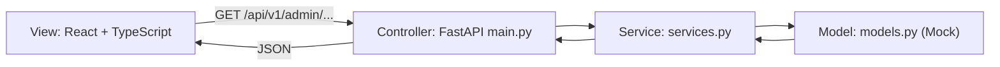
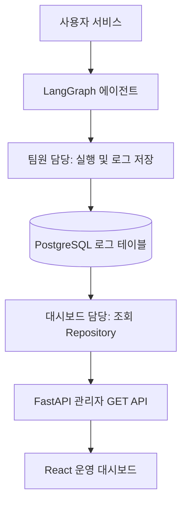

# 한강버스 AI 나들이 플래너 | 운영 대시보드

> **개발용 Mock MVP** · Python 3.11 / FastAPI / React 18 / TypeScript / Vite / Recharts
>
> 현재 데이터는 테스트용입니다. PostgreSQL, LangGraph, 서울시 문화행사 API, Kakao Maps에 실제 연결하지 않습니다.

## 1. 화면 미리보기


**주의:** 위 이미지는 UI 디자인 **시안**으로 실제 브라우저 실행 화면 캡처가 아닙니다. 코드와 픽셀 단위로 일치하지 않을 수 있습니다. 실제 실행 화면을 캡처하려면 아래 [화면 캡처 방법](#8-실제-화면-캡처-방법)을 따르세요.

## 2. 화면 구성

| 메뉴 | 담당 파일 | 주요 기능 | 조회 API |
|---|---|---|---|
| 운영 대시보드 | `DashboardPage.tsx` | 전체 실행·성공·실패·복구 건수, 일별 추이, 성공·실패 도넛 차트, 오류 원인별 차트, API 제공자별 응답시간 차트, 서비스 상태 | `/dashboard/summary`, `/dashboard/trends`, `/health` |
| 실행 이력 | `RunsPage.tsx` | 실행 ID/구간 검색, 상태 필터, 실행 목록, 선택한 실행의 에이전트 단계 및 Handoff | `/agent-runs`, `/agent-runs/{run_id}` |
| API 모니터링 | `ApiMonitoringPage.tsx` | 제공자별 호출 통계, 성공률, 응답 시간, 호출 결과 필터, 필터 적용 로그 CSV 다운로드 | `/api-calls` |
| 장애·복구 기록 | `IncidentsPage.tsx` | 장애 상태 필터, 심각도, 장애 상세 펼치기, 복구 시도 내역 | `/incidents` |

모든 API 경로 앞에는 `/api/v1/admin`이 붙습니다. 사이드바 이동은 현재 React 상태 기반이며 **URL 라우팅이 아니므로 새로고침하면 기본 화면으로 돌아갑니다.**

## 3. 폴더 및 파일 구조

```text
hanriver-admin/
├── README.md                         # GitHub 프로젝트 안내
├── docs/
│   └── screenshots/
│       └── dashboard-concept.png     # UI 디자인 시안 (실제 캡처 아님)
├── backend/
│   ├── requirements.txt              # Python 의존성
│   └── app/
│       ├── __init__.py               # Python 패키지 표시
│       ├── main.py                   # Controller: FastAPI GET 라우트, CORS, 데모 인증
│       ├── models.py                 # Model: Mock 실행·API·장애 데이터
│       └── services.py               # Service: 요약·추이·API 성능 집계
└── frontend/
    ├── index.html                    # React 마운트 HTML
    ├── package.json                  # npm 의존성 및 실행 스크립트
    ├── tsconfig.json                 # TypeScript 설정
    ├── .env.example                  # 개발용 환경변수 예시
    └── src/
        ├── main.tsx                  # React 진입점, 공통 레이아웃, 상태/데이터 조회
        ├── api.ts                    # fetch 함수, 응답 TypeScript 인터페이스
        ├── types.ts                  # 페이지 식별 타입
        ├── style.css                 # 공통 레이아웃·테이블·반응형 스타일
        ├── utils/
        │   └── exportCsv.ts           # 현재 필터 결과 CSV 다운로드 (UTF-8 BOM, 수식 주입 방지)
        ├── icons/
        │   └── index.ts              # Lucide 아이콘 중앙 export
        ├── config/
        │   └── navigation.ts         # 사이드바 메뉴/아이콘 설정
        ├── components/
        │   └── DashboardCommon.tsx   # 공통 카드, 상태 뱃지, 시간 포맷
        └── pages/
            ├── DashboardPage.tsx     # 운영 현황
            ├── RunsPage.tsx          # 실행 이력 및 단계 타임라인
            ├── ApiMonitoringPage.tsx # API 호출 성능/로그
            └── IncidentsPage.tsx     # 장애/복구 이력
```

### 설계 원칙: MVC 개념 + Service 계층



- **Model:** 현재는 메모리 테스트 데이터. 추후 PostgreSQL Repository로 교체합니다.
- **View:** React 페이지별 TSX, 공통 컴포넌트, 아이콘/메뉴 설정.
- **Controller:** GET API 요청과 인증/응답 처리.
- **Service:** 통계 집계 로직. 모든 엔드포인트가 Service를 거치는 것은 아니며 일부는 현재 Model을 직접 조회합니다.
- 엄격한 전통적 MVC가 아니라 **프론트/백 분리형 계층 구조에 MVC 역할을 대응시킨 설계**입니다.

## 4. 실행 방법

### 요구 사항

- Python **3.11**
- Node.js / npm (Vite 6 실행 가능 버전)

### 백엔드 (Windows PowerShell)

```powershell
cd backend
uv venv --python 3.11
.venv\Scripts\Activate.ps1
pip install -r requirements.txt
$env:ADMIN_API_KEY="local-demo-key"
uvicorn app.main:app --reload --port 8000
```

API 문서: http://localhost:8000/docs

### 프론트엔드 (다른 터미널)

```powershell
cd frontend
Copy-Item .env.example .env
npm install
npm run dev
uvicorn app.main:app --reload
```

대시보드: http://localhost:5173

> `frontend/.env.example`은 **로컬 데모 전용**입니다. 브라우저 번들에 포함되는 `VITE_` 변수는 비밀값으로 사용할 수 없습니다. 인터넷에 공개 배포하지 마세요.

## 5. 관리자 GET API 명세

| Method | 전체 경로 | 응답 주요 항목 | 데이터 소스 |
|---|---|---|---|
| GET | `/api/v1/admin/dashboard/summary?days=7` | total, success, failed, recovered, success_rate, avg_duration_ms | `agent_runs` 대응 Mock |
| GET | `/api/v1/admin/dashboard/trends?days=7` | 날짜별 success/failed/recovered 배열 | `agent_runs` 대응 Mock |
| GET | `/api/v1/admin/agent-runs` | 실행 목록 items, total | `agent_runs` 대응 Mock |
| GET | `/api/v1/admin/agent-runs/{run_id}` | run, steps, handoffs | `agent_runs`, `agent_step_logs`, `handoff_logs` 대응 Mock |
| GET | `/api/v1/admin/api-calls` | items, stats | `api_call_logs` 대응 Mock |
| GET | `/api/v1/admin/incidents` | items 및 recoveries | `incident_logs`, `recovery_logs` 대응 Mock |
| GET | `/api/v1/admin/health` | mode, checked_at, services | 테스트용 고정 상태 |

요청 헤더 (로컬 데모 전용):

```http
X-Admin-Key: local-demo-key
```

API 확인 예시:

```powershell
Invoke-RestMethod -Uri 'http://localhost:8000/api/v1/admin/dashboard/summary?days=7' -Headers @{ 'X-Admin-Key'='local-demo-key' }
```

**API 모니터링의 제공자 목록은 데이터에 따라 표시됩니다.** Kakao Maps 사용이 확정되지 않았다면 실제 연동 단계에서 해당 제공자의 로그를 생성하지 않으면 됩니다. 현재 Mock에는 예시 제공자가 들어갈 수 있습니다.

## 6. 데이터 흐름 및 팀 역할



- **서비스/에이전트 개발자:** `agent_runs`, `agent_step_logs`, `handoff_logs`, `api_call_logs`, `incident_logs`, `recovery_logs` 등에 실행 결과 기록.
- **대시보드 개발자:** GET API, 집계, 필터링, 조회 화면 구현. 에이전트 실행이나 복구 명령을 직접 수행하지 않음.
- **통합 시:** Mock 모델을 DB Repository로 교체하고 `frontend/src/api.ts` 응답 타입과 계약을 일치시킵니다.

## 7. 실제 DB 연동 전 체크리스트

- [ ] `run_id`, `status`, `started_at`, `step_order`, `duration_ms` 공통 규칙 합의
- [ ] `agent_runs` 등 로그 테이블에 테스트 레코드 저장
- [ ] Model Mock을 PostgreSQL 조회로 교체
- [ ] 목록 API 페이지네이션/기간 필터 추가
- [ ] 실패/복구/실행 중 상태 집계 기준 통일
- [ ] `/health`를 실제 서비스 상태 검사로 교체
- [ ] 관리자 인증을 세션/서버 인증으로 교체하고 HTTPS 적용
- [ ] API 키, 개인정보, 원본 프롬프트 등 민감정보 로깅 금지
- [ ] React 빌드, 브라우저 화면, 백엔드 통합 테스트 완료

## 8. 실제 화면 캡처 방법

현재 저장소에는 **디자인 시안만** 포함되어 있으며 실제 React 실행 캡처는 없습니다. 아래 순서로 실제 화면을 촬영한 뒤 GitHub README에 추가하세요.

1. 백엔드와 프론트엔드를 실행합니다.
2. 브라우저에서 `http://localhost:5173`에 접속합니다.
3. 사이드바에서 `운영 대시보드`, `실행 이력`, `API 모니터링`, `장애·복구 기록`을 차례로 선택합니다.
4. 각 화면을 캡처해 `docs/screenshots/dashboard.png`, `runs.png`, `api.png`, `incidents.png`로 저장합니다.
5. 아래 마크다운을 README의 화면 소개 영역에 추가합니다.

```md


```

## 9. 현재 구현 범위 및 제한

- Mock GET API 7개 및 화면 4개가 포함됩니다.
- PostgreSQL, LangGraph, 외부 API 호출은 **아직 구현되어 있지 않습니다**.
- `GET /health`의 값은 실제 서버 상태 검사가 아닙니다.
- 페이지 이동은 상태 기반으로 브라우저 URL을 변경하지 않습니다.
- 이 문서 작성 시점에 npm 의존성 설치/실제 브라우저 실행 검증은 완료하지 못했습니다.


## v1.5 — LangGraph / LLM 장애 원인 분리

- **운영 대시보드:** 서비스 상태에서 `LangGraph`와 `LLM API`를 별도로 표시하고, 실행 로그의 최초 장애 원인을 구분합니다.
- **실행 이력:** `failure_source` 및 `error_code`를 실행·노드 단계에서 표시합니다. `RECOVERED`는 복구되었더라도 최초 오류 원인을 보존합니다.
- **API 모니터링:** LLM 제공자 호출 기록 및 HTTP 오류(예: 429)를 다른 외부 API와 함께 표시합니다.
- **장애·복구 기록:** 장애 원인 `LANGGRAPH` / `LLM` 등을 표시합니다.
- **백엔드:** 기존 7개 GET 엔드포인트 유지. 현재 데이터와 health는 모두 **MOCK**입니다. 실제 LangGraph/LLM 연결 점검을 수행하지 않습니다.

### 로그 데이터 연동 계약

`agent_runs.failure_source`, `incident_logs.failure_source` 및 실패한 `agent_step_logs.failure_source`에 `LANGGRAPH`, `LLM`, `EXTERNAL_API`, `DATABASE` 중 하나를 기록하도록 에이전트 담당자와 합의해야 합니다. 성공 기록은 `null`입니다. `error_code`는 세부 오류 유형을 담습니다. 현재 DB 스키마에 필드가 없다면 컬럼 추가 또는 오류 유형 매핑 로직이 필요합니다.

**분류 기준:** LangGraph 노드 이동·상태 업데이트·Handoff 자체의 오류는 `LANGGRAPH`; 모델 인증·요청 제한·타임아웃·모델 응답 파싱 오류는 `LLM`. 동일 실행에서 여러 장애가 발생하면 개별 `incident_logs`에 각각 기록하고 실행 대표 `failure_source`는 최초 주요 장애로 지정합니다.

**주의:** `NOT_CONNECTED` / `NOT_CHECKED`는 점검되지 않았음을 의미하며, 서비스 장애를 확인했다는 뜻이 아닙니다. 실제 헬스체크 구현 전까지 서비스 상태를 정상/장애로 판단하지 마세요.


## v1.6 UUID 로그 계약 (중요)

- `backend/schema.sql`: PostgreSQL 18용 6개 운영 로그 테이블 UUID DDL. **기존 전체 서비스 DB를 대체하는 스키마가 아니라 운영 로그 테이블 부분만** 정의합니다.
- `run_id`, `step_log_id`, `api_call_id`, `handoff_id`, `incident_id`, `recovery_id`: DB UUID / API JSON 문자열 / React `UUID` 타입(`string`).
- 실행 상태: `RUNNING`, `SUCCESS`, `FAILED`; 장애 상태: `OPEN`, `RECOVERING`, `RESOLVED`; 복구 시도: `RUNNING`, `RECOVERED`, `FAILED`.
- 실행 성공과 복구 성공은 별도 집계합니다. 성공적으로 복구된 실행의 최종 상태는 `SUCCESS`입니다.
- `agent-runs/{run_id}`는 FastAPI의 UUID 검증을 사용하며 형식 오류는 HTTP 422입니다.
- `handoff_logs`는 `run_id`, `status`, `error_source`, `error_code`를 포함합니다.
- Mock API 데이터는 **실제 UUID 형식의 고정 예시 ID**를 사용하며 Kakao Maps 예시는 제거했습니다.
- 현재 구현은 여전히 **Mock 저장소**입니다. `DATABASE_URL`을 사용한 PostgreSQL 실제 쿼리 연동은 아직 하지 않았으며, 별도 DB 접속 정보와 운영 권한 설계가 필요합니다.
- 개발용 `VITE_DEMO_ADMIN_KEY`는 실제 운영 인증 수단이 아닙니다. 운영 배포 시 서버 세션/OIDC 등으로 대체해야 합니다.

## v1.7 변경 사항 — CSV 다운로드 및 메인 차트

- **API 모니터링 → API 호출 로그:** `CSV 다운로드` 버튼을 추가했습니다. 제공자/성공 여부 필터를 적용한 **현재 표시 목록만** CSV로 내려받습니다. 필터 결과가 0건이면 버튼이 비활성화됩니다.
- CSV 컬럼은 `api_call_id`, `run_id`, `provider`, `api_type`, `http_status`, `success`, `latency_ms`, `error_source`, `error_code`, `called_at`이며 UUID를 축약하지 않고 전체 저장합니다.
- Excel 한글 호환을 위해 UTF-8 BOM을 사용하고 CSV 셀 이스케이프 및 수식 주입 방지를 적용했습니다. 현재는 **브라우저에 로드된 Mock/조회 데이터**를 내려받으며, 실제 DB의 전체 기간/전체 페이지를 서버에서 내보내는 기능은 아닙니다.
- **메인 대시보드:** 기존 일별 추이 외에 실행 성공·실패 도넛 차트, 오류 발생 위치별 막대 차트, API 제공자별 평균 응답시간 차트를 추가했습니다.
- 그래프는 기존 GET API 응답을 재사용하므로 새 엔드포인트가 필요하지 않습니다. `failure_by_source`는 기존 요약 API의 집계 기준을 그대로 따릅니다.
