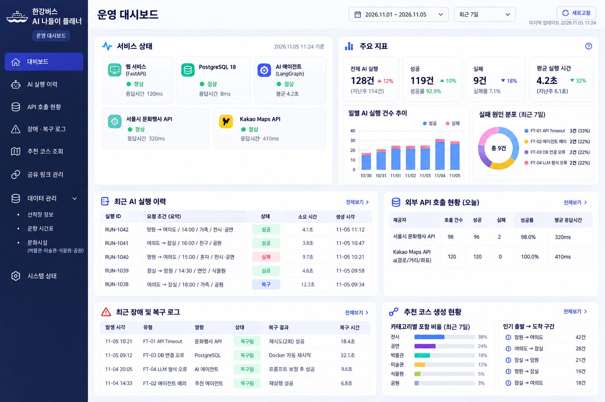
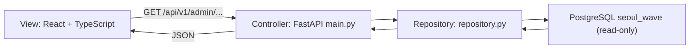
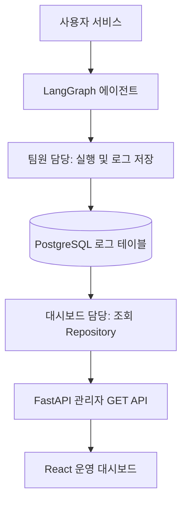
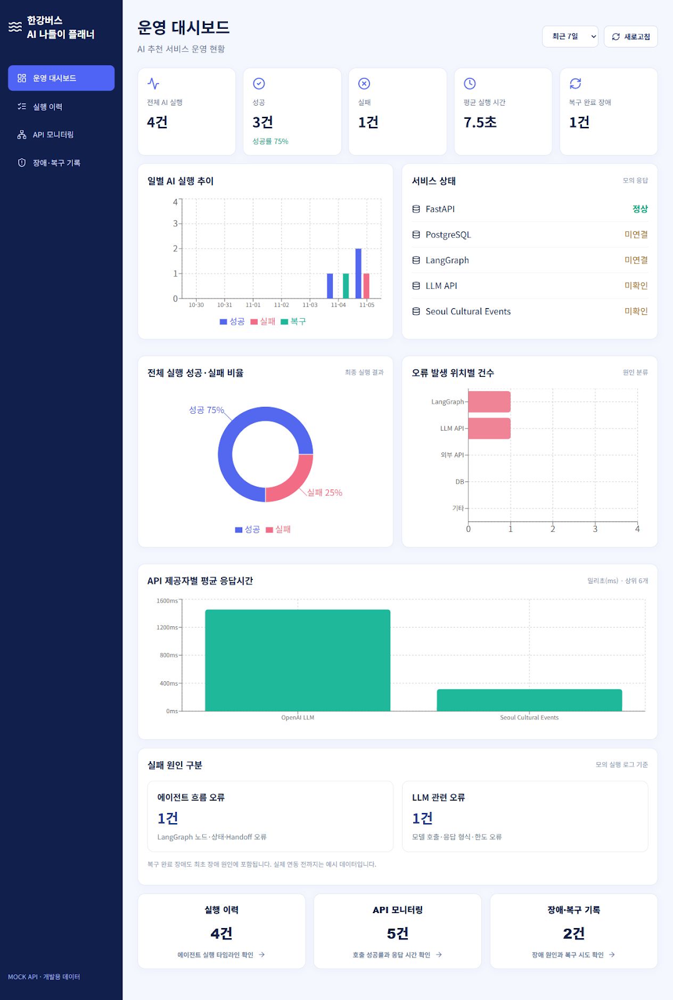
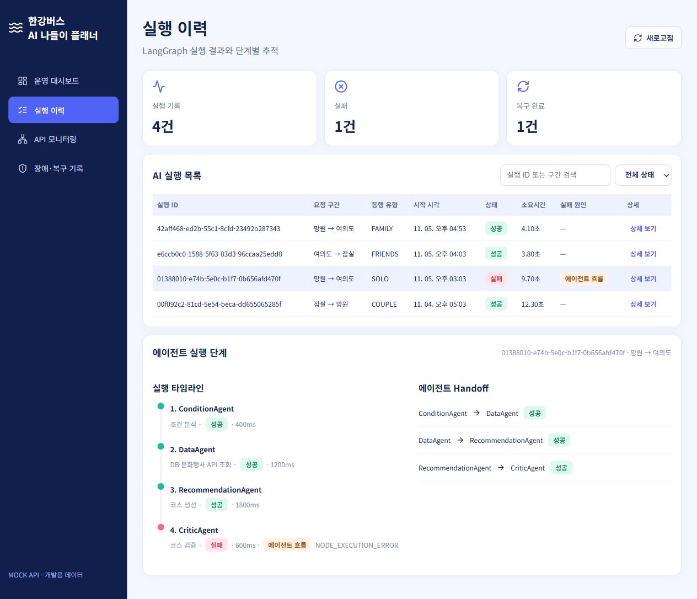
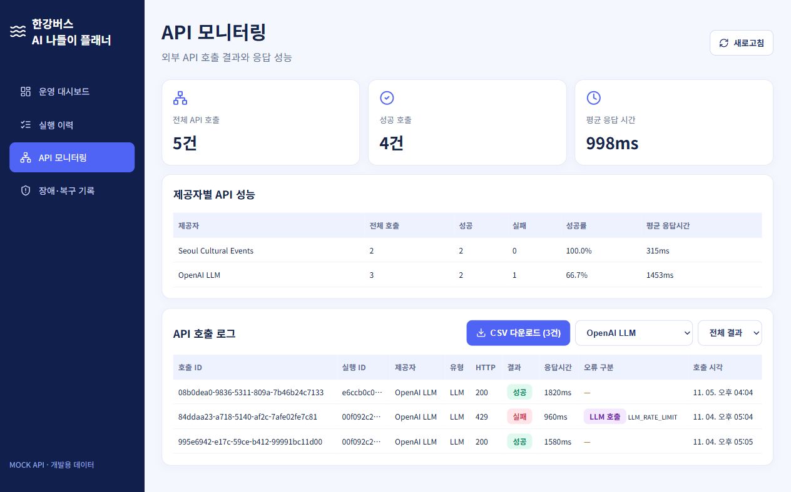
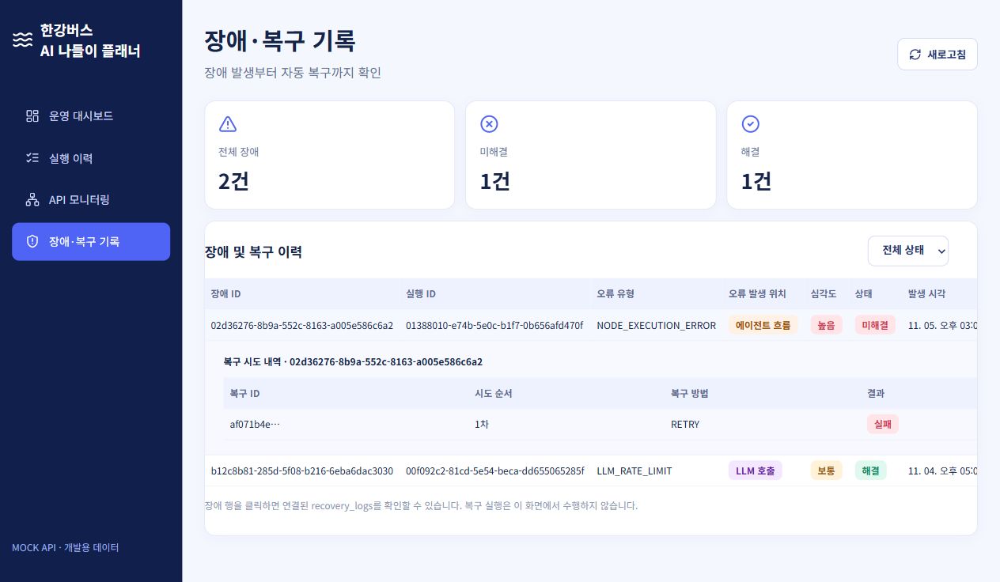

# 한강버스 AI 나들이 플래너 | 운영 대시보드

> **PostgreSQL 운영 로그 대시보드** · Python 3.11 / FastAPI / React 18 / TypeScript / Vite / Recharts
>
> FastAPI는 SEOUL-WAVE가 사용하는 PostgreSQL의 기존 운영 로그 테이블을 읽기 전용으로 조회합니다. LangGraph 및 외부 서비스 상태를 직접 점검하거나 실행하지는 않습니다.

## 1. 화면 미리보기



**주의:** 위 이미지는 UI 디자인 **시안**으로 실제 브라우저 실행 화면 캡처가 아닙니다. 코드와 픽셀 단위로 일치하지 않을 수 있습니다. 실제 실행 화면을 캡처하려면 아래 [화면 캡처 방법](#8-실제-화면-캡처-방법)을 따르세요.

## 2. 화면 구성

| 메뉴 | 담당 파일 | 주요 기능 | 조회 API |
|---|---|---|---|
| 운영 대시보드 | `DashboardPage.tsx` | 전체 실행·성공·실패·복구 건수, 일별 추이, 성공·실패 도넛 차트, 오류 원인별 차트, API 제공자별 응답시간 차트, 서비스 상태 | `/dashboard/summary`, `/dashboard/trends`, `/health` |
| 실행 이력 | `RunsPage.tsx` | 실행 ID/구간 검색, 상태 필터, 실행 목록, 선택한 실행의 에이전트 단계 및 Handoff | `/agent-runs`, `/agent-runs/{run_id}` |
| API 모니터링 | `ApiMonitoringPage.tsx` | 제공자별 호출 통계, 성공률, 응답 시간, 호출 결과 필터, 필터 적용 로그 CSV 다운로드 | `/api-calls` |
| 장애·복구 기록 | `IncidentsPage.tsx` | 장애 상태 필터, 심각도, 장애 상세 펼치기, 복구 시도 내역 | `/incidents` |

모든 API 경로 앞에는 `/api/v1/admin`이 붙습니다. 사이드바 이동은 현재 React 상태 기반이며 **URL 라우팅이 아니므로 새로고침하면 기본 화면으로 돌아갑니다.**

## 3. 폴더 및 파일 구조

```text
hanriver-admin/
├── README.md                         # GitHub 프로젝트 안내
├── docs/
│   └── screenshots/
│       └── dashboard-concept.png     # UI 디자인 시안 (실제 캡처 아님)
├── backend/
│   ├── Dockerfile                    # 관리자 API 컨테이너
│   ├── requirements.txt              # Python 의존성
│   └── app/
│       ├── __init__.py               # Python 패키지 표시
│       ├── main.py                   # FastAPI 라우트 및 관리자 키 검증
│       ├── database.py               # 읽기 전용 PostgreSQL 연결 및 스키마 확인
│       └── repository.py             # 운영 로그 SQL 조회/집계
├── docker-compose.admin.yml          # SEOUL-WAVE Compose에 admin 서비스를 추가하는 오버레이
└── frontend/
    ├── Dockerfile                    # 관리자 Vite 컨테이너
    ├── .dockerignore                 # 환경변수 파일과 빌드 산출물 제외
    ├── index.html                    # React 마운트 HTML
    ├── package.json                  # npm 의존성 및 실행 스크립트
    ├── tsconfig.json                 # TypeScript 설정
    └── src/
        ├── main.tsx                  # React 진입점, 공통 레이아웃, 상태/데이터 조회
        ├── api.ts                    # fetch 함수, 응답 TypeScript 인터페이스
        ├── vite-env.d.ts             # Vite 환경변수 타입
        ├── types.ts                  # 페이지 식별 타입
        ├── style.css                 # 공통 레이아웃·테이블·반응형 스타일
        ├── utils/
        │   └── exportCsv.ts           # 현재 필터 결과 CSV 다운로드 (UTF-8 BOM, 수식 주입 방지)
        ├── icons/
        │   └── index.ts              # Lucide 아이콘 중앙 export
        ├── config/
        │   └── navigation.ts         # 사이드바 메뉴/아이콘 설정
        ├── components/
        │   └── DashboardCommon.tsx   # 공통 카드, 상태 뱃지, 시간 포맷
        └── pages/
            ├── DashboardPage.tsx     # 운영 현황
            ├── RunsPage.tsx          # 실행 이력 및 단계 타임라인
            ├── ApiMonitoringPage.tsx # API 호출 성능/로그
            └── IncidentsPage.tsx     # 장애/복구 이력
```

### 설계 원칙: MVC 개념 + Repository 계층



- **Repository:** 기존 `003_operations_logging.sql`이 정의한 운영 로그 테이블만 조회합니다. 대시보드가 로그를 새로 생성하거나 별도 테이블을 만들지 않습니다.
- **View:** React 페이지별 TSX, 공통 컴포넌트, 아이콘/메뉴 설정.
- **Controller:** GET API 요청과 관리자 키/CORS 처리.
- **Database:** `DATABASE_HOST`, `DATABASE_PORT`, `DATABASE_NAME`, `DATABASE_USER`, `DATABASE_PASSWORD`로 연결하며 DB 연결은 읽기 전용입니다.
- 엄격한 전통적 MVC가 아니라 **프론트/백 분리형 계층 구조에 MVC 역할을 대응시킨 설계**입니다.

## 4. 실행 방법

팀원이 두 저장소를 준비하고, 로컬 환경변수와 운영 로그 테이블까지 설정하는 단계별 안내는 [TEAM_SETUP.md](./TEAM_SETUP.md)를 참고하세요.

### 요구 사항

- Docker Desktop / Docker Compose
- SEOUL-WAVE 저장소와 SEOUL-WAVE_admin 저장소가 같은 상위 디렉터리에 있어야 합니다.

### SEOUL-WAVE + admin 전체 Compose 실행

```powershell
Set-Location ..\SEOUL-WAVE
# SEOUL-WAVE\.env에 로컬 개발용 ADMIN_API_KEY=<충분히 긴 임의의 비밀값> 한 줄을 추가합니다.
docker compose -f compose.yaml -f ..\SEOUL-WAVE_admin\docker-compose.admin.yml up --build -d
```

이 방식은 SEOUL-WAVE의 `db`, `backend`, `itinerary-worker`, `frontend`와 admin의 `admin-api`, `admin-frontend`를 **한 Compose 프로젝트 및 같은 PostgreSQL 컨테이너/볼륨**에서 실행합니다. 별도의 공용 DB 주소는 설정하지 않습니다. DB 접속은 내부 Docker 네트워크의 `db:5432`를 사용하고, admin API는 호스트 `127.0.0.1:8002`, admin 화면은 `127.0.0.1:5175`에만 노출됩니다. 기존 `postgres_data` 볼륨은 유지되며 삭제하거나 초기화하지 않습니다.

현재 PC의 DB에 로그 테이블이 아직 없다면, **한 번만** 아래 migration 작업을 실행합니다. 먼저 현재 DB를 백업하고, 기존 스키마 상태를 확인한 뒤 실행하세요. 이 명령은 SEOUL-WAVE 저장소의 기존 `003_operations_logging.sql`을 실행하며, 데이터베이스 테이블을 생성합니다. 이미 여섯 테이블이 있다면 다시 실행하지 마세요. 다른 컴퓨터의 DB에 있던 기존 로그 행들은 이 migration으로 복사되지 않습니다.

```powershell
docker compose -f compose.yaml -f ..\SEOUL-WAVE_admin\docker-compose.admin.yml --profile db-migration run --rm db-migrate-operations
docker compose -f compose.yaml -f ..\SEOUL-WAVE_admin\docker-compose.admin.yml up --build -d
```

상태 확인: http://localhost:8002/api/v1/admin/health · API 문서: http://localhost:8002/docs · 대시보드: http://localhost:5175

기존 SEOUL-WAVE 최상위 `.env`에 `ADMIN_API_KEY` 한 줄만 추가하면 Compose가 같은 값을 API 인증 및 `VITE_DEMO_ADMIN_KEY`에 전달합니다. 다른 `.env` 파일은 추가로 필요하지 않습니다. 이 키는 로컬 개발용이며 브라우저에 포함되므로 외부에 공개하지 마세요. 현재 서비스는 localhost에만 바인딩됩니다. 팀원이 원격으로 접속해야 한다면 별도 서버 배포와 HTTPS/서버 인증을 추가해야 합니다.

## 5. 관리자 GET API 명세

| Method | 전체 경로 | 응답 주요 항목 | 데이터 소스 |
|---|---|---|---|
| GET | `/api/v1/admin/dashboard/summary?days=7` | total, success, failed, recovered, success_rate, avg_duration_ms | `agent_runs`, `incident_logs`, `recovery_logs` |
| GET | `/api/v1/admin/dashboard/trends?days=7` | 날짜별 success/failed/recovered 배열 | `agent_runs`, `recovery_logs` |
| GET | `/api/v1/admin/agent-runs` | 실행 목록 items, total | `agent_runs` |
| GET | `/api/v1/admin/agent-runs/{run_id}` | run, steps, handoffs | `agent_runs`, `agent_step_logs`, `handoff_logs` |
| GET | `/api/v1/admin/api-calls` | items, stats | `api_call_logs` |
| GET | `/api/v1/admin/incidents` | items 및 recoveries | `incident_logs`, `recovery_logs` |
| GET | `/api/v1/admin/health` | PostgreSQL 연결 및 6개 로그 테이블 존재 여부 | 실제 PostgreSQL 검사 |

연결하지 못하거나 필요한 테이블이 없으면 관리자 API는 HTTP 503을 반환하고, health 응답에 DB 연결/스키마 상태를 표시합니다. Mock/SQLite 데이터로 대체하지 않습니다. 실행 구간과 동행 유형은 공통 운영 로그 스키마에 컬럼이 없어 `—`로 표시됩니다.

요청 헤더:

```http
X-Admin-Key: <SEOUL-WAVE/.env의 ADMIN_API_KEY>
```

API 확인 예시:

```powershell
Invoke-RestMethod -Uri 'http://localhost:8002/api/v1/admin/dashboard/summary?days=7' -Headers @{ 'X-Admin-Key'='<ADMIN_API_KEY>' }
```

**API 모니터링의 제공자 목록은 실제 `api_call_logs` 데이터에 따라 표시됩니다.** Kakao Maps 로그는 해당 호출이 실제로 구성된 경우에만 나타납니다.

## 6. 데이터 흐름 및 팀 역할



- **서비스/에이전트 개발자:** `agent_runs`, `agent_step_logs`, `handoff_logs`, `api_call_logs`, `incident_logs`, `recovery_logs` 등에 실행 결과 기록.
- **대시보드 API:** 기존 운영 로그를 읽기 전용으로 조회합니다. 에이전트 실행이나 복구 명령을 수행하지 않습니다.
- **SEOUL-WAVE 서비스:** 실행/단계/API/장애/복구 데이터를 같은 `run_id`로 기록해야 대시보드 상세 화면에 연결됩니다.

## 7. 운영 연결 확인사항

- 사용자 서비스와 admin 컨테이너가 같은 PostgreSQL `seoul_wave` 및 같은 `003_operations_logging.sql` 테이블을 사용하는지 확인합니다.
- admin API의 PostgreSQL 세션은 읽기 전용입니다. 로컬 Compose에서는 SEOUL-WAVE와 같은 DB 계정을 사용하며, 대시보드는 로그 테이블을 생성하거나 수정하지 않습니다. 외부/운영 배포에서는 별도의 `SELECT` 전용 DB 계정을 사용하세요.
- `health`에서 PostgreSQL 연결과 필수 테이블 6개가 모두 `UP`인지 확인합니다. 없는 테이블은 사용자 서비스의 migration 적용 상태를 확인합니다.
- 로컬 개발 구성에서 브라우저의 `VITE_DEMO_ADMIN_KEY`는 브라우저 번들에 포함됩니다. 인터넷에 공개하는 배포에는 사용하지 마세요.
- 프롬프트, 응답 본문, API 키, 개인정보는 로그에 저장하지 않습니다.

## 8. 실제 화면 캡처 방법

현재 저장소에는 **디자인 시안만** 포함되어 있으며 실제 React 실행 캡처는 없습니다. 아래 순서로 실제 화면을 촬영한 뒤 GitHub README에 추가하세요.

1. 백엔드와 프론트엔드를 실행합니다.
2. 브라우저에서 `http://localhost:5175`에 접속합니다.
3. 사이드바에서 `운영 대시보드`, `실행 이력`, `API 모니터링`, `장애·복구 기록`을 차례로 선택합니다.
4. 각 화면을 캡처해 `docs/screenshots/dashboard.png`, `runs.png`, `api.png`, `incidents.png`로 저장합니다.
5. 아래 마크다운을 README의 화면 소개 영역에 추가합니다.

```md




```

위 화면 시안은 구현 화면 캡처가 아닙니다. 브라우저에서 실제 화면을 캡처하려면 위 실행 절차로 프론트엔드를 실행한 뒤 사이드바의 네 화면을 촬영하세요.

## 9. 현재 구현 범위 및 제한

- PostgreSQL 운영 로그 조회 GET API 7개 및 화면 4개가 포함됩니다.
- LangGraph나 외부 API 자체를 호출하지 않으며, DB에 저장된 로그만 보여줍니다.
- 공통 로그 스키마에는 `route`, `companion_type` 컬럼이 없어 실행 목록에 표시하지 않습니다.
- 각 목록 응답은 UI에 맞춰 최대 500~1000행으로 제한됩니다. 전체 내보내기/서버 페이지네이션은 제공하지 않습니다.
- 페이지 이동은 상태 기반으로 브라우저 URL을 변경하지 않습니다.

## v1.7 변경 사항 — CSV 다운로드 및 메인 차트

- **API 모니터링 → API 호출 로그:** `CSV 다운로드` 버튼을 추가했습니다. 제공자/성공 여부 필터를 적용한 **현재 표시 목록만** CSV로 내려받습니다. 필터 결과가 0건이면 버튼이 비활성화됩니다.
- CSV 컬럼은 `api_call_id`, `run_id`, `provider`, `api_type`, `http_status`, `success`, `latency_ms`, `error_source`, `error_code`, `called_at`이며 UUID를 축약하지 않고 전체 저장합니다.
- Excel 한글 호환을 위해 UTF-8 BOM을 사용하고 CSV 셀 이스케이프 및 수식 주입 방지를 적용했습니다. 현재는 브라우저에 로드된 조회 데이터만 내려받으며, 실제 DB의 전체 기간/전체 페이지를 서버에서 내보내는 기능은 아닙니다.
- **메인 대시보드:** 기존 일별 추이 외에 실행 성공·실패 도넛 차트, 오류 발생 위치별 막대 차트, API 제공자별 평균 응답시간 차트를 추가했습니다.
- 그래프는 기존 GET API 응답을 재사용하므로 새 엔드포인트가 필요하지 않습니다. `failure_by_source`는 기존 요약 API의 집계 기준을 그대로 따릅니다.
